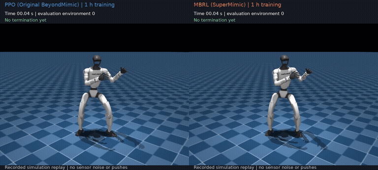
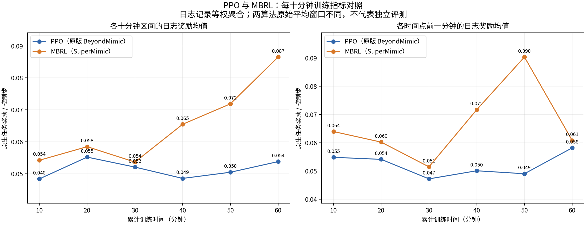

# G1 站立控制：MBRL 与 PPO 对照实验

在同一静态站立任务上，对比 **MBRL（SuperMimic）** 与 **PPO（原版 BeyondMimic）**，两组各累计训练约 1 小时。

本项目基于 `whole_body_tracking`（BeyondMimic 运动跟踪项目）的代码版本修改而来，在其基础上加入参考 SuperMimic 思路的可微世界模型训练，并开展与 PPO 的对照实验。

MBRL 是基于 SuperMimic 思路的独立适配；PPO 保留原生 RSL-RL PPO 算法，为对齐对照调整了网络、输入和任务接口，并非 BeyondMimic 完整默认配置。

## 相同与不同

| 对照项 | PPO（原版 BeyondMimic） | MBRL（SuperMimic） |
|---|---|---|
| 机器人、参考动作 | 同一 29 自由度 G1、同一静态站姿 | 相同 |
| 仿真与任务 | 50 Hz；同一物理资产、奖励和终止条件 | 相同 |
| 网络与输入 | 匹配的策略 / critic；10 帧本体观测和未来 10 帧参考；相同初始权重、固定归一化 | 相同；额外训练动力学模型 |
| 训练预算 | 256 环境、seed=42；10 分钟后续训 50 分钟；同时共享一张 GPU | 相同 |
| 扰动与采样 | 关闭推扰、域随机化、观测噪声和回报重置采样 | 相同 |
| 策略优化 | 仿真交互数据上的原生 PPO 更新 | 学习动力学模型，通过想象轨迹反向传播更新策略 |
| 动作探索 | 初始标准差 0.1，训练中学习 | 采集噪声标准差固定为 0.1 |

## 结果

| 训练 1 小时后的独立评测 | PPO（原版 BeyondMimic） | MBRL（SuperMimic） |
|---|---:|---:|
| 完成 20 秒站立 | 12/32 | 32/32 |
| 20 秒内平均维持时间 | 9.63 s | 20.00 s |
| 20 秒测试关节 RMSE | 0.415 rad | 0.144 rad |
| 完成独立 60 秒站立测试 | 16/32 | 32/32 |

每十分钟曲线来自训练日志；成功数和关节误差只评测了 10、60 分钟的检查点。单训练种子、共享 GPU、无扰动仿真；32 个副本不是独立种子，当前不据此声称训练加速或真机效果。GIF 固定展示环境 0，PPO 终止后冻结画面。

[详细实验条件与数据](docs/EXPERIMENTS.md) · [运行说明](docs/RUNNING.md) · [实现与复现说明](docs/REPRODUCIBILITY.md) · [60 秒 MP4](media/ppo_vs_mbrl_60s.mp4) · [来源与授权](NOTICE.md)
