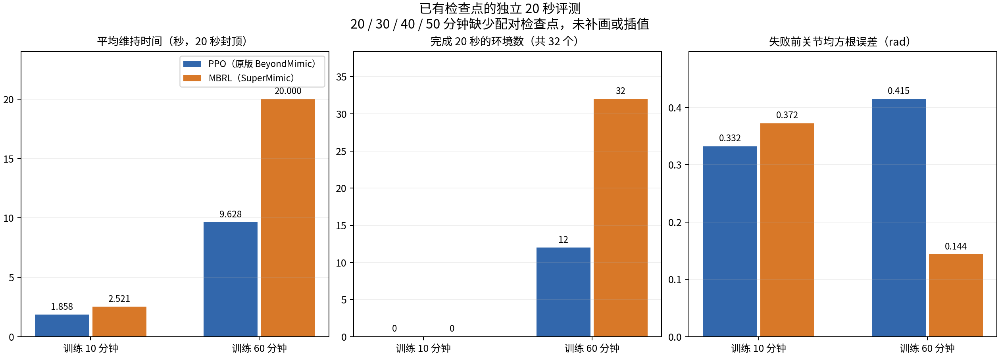

# PPO（原版 BeyondMimic）与 MBRL（SuperMimic）站立对照

文中的括号表示方法来源。PPO 为匹配对照调整了网络、输入和任务接口；MBRL 是 SuperMimic 思路的独立适配。

## 协议

Unitree G1，固定站姿，50 Hz 控制。每组 256 个训练环境，seed=42，在同一张 GPU 同时训练。初次训练 600 秒，恢复模型及优化器后继续 3000 秒。仿真状态和 MBRL 回放重新启动，不是逐位连续恢复。

两组使用相同的 actor/critic 初始权重、固定归一化、10 帧 93 维本体观测、未来 10 帧参考编码及 32 维 tanh latent。初始动作噪声标准差为 0.1；PPO 的标准差在训练中按原生算法学习。关闭推扰、域随机化、传感器噪声与回报重置采样，使用一致的骨盆奖励和终止条件。PPO 适配网络接口，不能称为原始 IsaacLab 工程完全不改的基线。

## 结果

| 20 秒评测 | PPO：10 分钟 | MBRL：10 分钟 | PPO：1 小时 | MBRL：1 小时 |
|---|---:|---:|---:|---:|
| 平均触发失败时间（秒，20 秒封顶） | 1.858 | 2.521 | 9.628 | 20.000 |
| 完成环境数 | 0/32 | 0/32 | 12/32 | 32/32 |
| 回报 | 5.375 | 7.875 | 27.901 | 95.459 |
| 失败前平均关节 RMSE（rad） | 0.332 | 0.372 | 0.415 | 0.144 |

独立 60 秒测试：PPO 完成 16/32，平均维持 31.694 秒；MBRL 完成 32/32。关节 RMSE 分别为 0.419 和 0.149 rad。

20 秒和 60 秒测试各自重建仿真运行，不能按同一批轨迹解释；PPO 的成功数从 12 变成 16 不是“运行更久成功率更高”。变化来源没有专门诊断。浮点累加得到略大于 20/60 的时长，展示按实际测试上限处理。

## 视频的含义

录像回放保存的**物理仿真轨迹**，不重新生成运动。固定采用环境 0，没有挑选最佳/最差样本。25 fps，正常速度，同一相机。PPO 触发终止后冻结最后记录的终止前画面，不播放自动重置后的动作。20 秒样本终止于 3.46 秒，独立 60 秒样本终止于 3.70 秒；MBRL 两段均未终止。

60 秒评测对静态参考进行长度扩展，防止原始 30 秒片段结束引起跳转。首个 MBRL 副本有 3000 个控制步，终止次数 0，骨盆高度约 0.723–0.749 m。

## 边界

- 只有一个训练种子。32 个标称副本不是独立训练种子。
- 没有扰动鲁棒性、多动作泛化或真机验证。
- 关节误差只在各策略失败前统计，时间支持不同；回报受生存时长影响。
- “通过站立”指未越过骨盆高度/倾斜终止阈值，不代表完全静止或精确重合参考。
- 两任务共享 GPU，没有测量达到同一性能目标所需的独占 GPU 时间，不报告加速倍数。
- 训练曲线按十分钟区间及时间点前一分钟聚合，但原始日志的平均窗口不同，不能据此严谨比较奖励方差。

数据见 [evaluation.json](../results/standing_1h/evaluation.json)，发布包未改写原始指标数值。

## 每十分钟的数据对照

[每十分钟数据表 CSV](../results/standing_1h/ten_minute_training.csv) 给出 10、20、30、40、50、60 分钟六个阶段。左图按 (0,10]、(10,20] 等累计训练分钟区间，对日志中的每条 `reward_native` 记录等权取均值；右图仅汇总各时间点前一分钟的记录，用于观察该阶段末的训练状态。续训日志时间加上初次训练的预算 600 秒。日志条数、首末采样时间也保存在表中，可核对边界。超过 600/3000 秒预算的小量日志不用于对应区间统计。

这些是训练过程中的奖励，包含探索动作、失败与重置，**不是每十分钟重新运行的无探索评测**。两算法日志平均窗口和记录频率不同，不能用记录条数当独立样本数，也不能用这些均值证明统计显著性。中间四个时刻没有成对保留的模型检查点（MBRL 的 latest 被覆盖），所以目前只对 10 和 60 分钟的检查点报告成功数、维持时间及关节误差。没有对缺失的评测进行插值。

## 对照条件与算法差异

| 项目 | 两组共同条件 / 差异 |
|---|---|
| 机器人和动作 | 同一 29 自由度 G1、同一静态站姿参考文件、相同关节顺序和物理资产 |
| 仿真与控制 | 同一 mjlab / MuJoCo 环境，控制周期 0.02 秒（50 Hz），训练每组 256 个环境 |
| 时间预算 | 首次 600 秒，再各续训 3000 秒；按训练计时预算比较，不包含所有初始化与离线评测耗时 |
| 计算资源 | 两组同时共享一张 GPU，算力竞争；不是独占硬件速度基准 |
| 初始化 | seed=42；相同 actor / critic 初始权重及固定归一化；不保证随机采样轨迹逐步一致 |
| 策略输入 | 10 帧、每帧 93 维本体观测；未来 10 帧参考编码；32 维 tanh 目标潜变量 |
| 网络 | 策略编码器/解码器隐藏层 512/256/128，critic 隐藏层 256/128；MBRL 另有 2048×3 动力学网络 |
| 奖励与终止 | 相同原生跟踪任务奖励、骨盆锚点与终止条件；训练 episode 上限 20 秒 |
| 扰动 | 无推扰、域随机化及观测噪声；关闭回报重置采样 |
| 探索 | 初始动作标准差均为 0.1；MBRL 使用设置的采集噪声，PPO 标准差随训练学习 |
| 更新方式 | PPO 使用原生 RSL-RL PPO；MBRL 使用学习动力学模型的想象轨迹和反向传播更新策略；更新次数/交互步数不强制相同 |
| 恢复 | 恢复各自权重与优化器；仿真重启，MBRL 回放重建，因此不是无缝连续训练 |
| 评测 | 每次 32 个标称副本，无动作探索；20 秒与独立 60 秒测试分别运行；不是 32 个独立训练种子 |

这里的 PPO 是匹配网络和输入后的原生 PPO 算法，不是整个 BeyondMimic 原始训练配置完全不动。当前结果用于研究这种匹配条件下的站立表现，不用于推断其他任务、真机效果或普遍加速比例。

## GIF 展示

[60 秒动图](../media/PPO与MBRL站立对照_60秒动图.gif)

仅保留一段 60 秒 GIF，来自同一份对照视频，768 像素宽、10 fps、正常速度、循环播放。降低帧率仅用于减小文件；未加速。PPO 终止后保留视频中的冻结画面及终止提示。MP4 保留作为更清晰、体积更小的下载版本。

### 六个阶段的区间奖励均值

| 累计训练时间 | PPO | MBRL |
|---|---:|---:|
| 10 分钟 | 0.04841 | 0.05424 |
| 20 分钟 | 0.05522 | 0.05848 |
| 30 分钟 | 0.05210 | 0.05366 |
| 40 分钟 | 0.04855 | 0.06549 |
| 50 分钟 | 0.05048 | 0.07187 |
| 60 分钟 | 0.05381 | 0.08652 |
